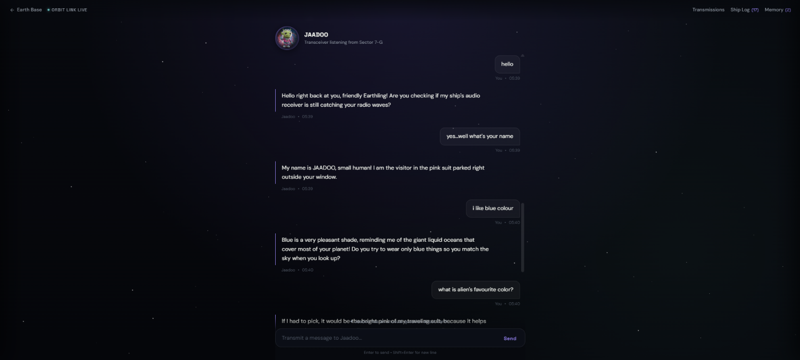

# 👽 JAADOO — Interactive AI Alien Agent

Jaadoo is a full-stack, atmospheric AI conversational agent. Peering in through a spaceship porthole terminal in high orbit above Earth, Jaadoo is a curious, innocent, and charming kid-alien from Sector 7-G who learns about humanity through conversations.



---

## ✨ Features

- **Atmospheric Spaceship Terminal UI**: Full-screen deep space cosmic background with twinkling starfield, ambient violet lighting, and responsive letter-by-letter transmission reveals.
- **Jaadoo Character Viewport**: Animated porthole showcasing Jaadoo's character, with smooth floating idle states and real-time frequency-decoding "thinking" animations.
- **Configurable LLM Provider Engine**: Decoupled, provider-agnostic architecture powered by Google Gemini (`gemini-3.5-flash-lite` / `gemini-3-flash-preview`), complete with automated exponential backoff retry handling for rate limits (429) and labeled in-character fallback mode.
- **Three-Tier Persistent Memory System**:
  - **System 1 (User Memory)**: Captures personal facts (name, pet, favorite food) while filtering sensitive details.
  - **System 2 (Earth Knowledge)**: Cumulatively decodes and reinforces Earth concepts across all interactions.
  - **System 3 (Alien Diary)**: Automatically compiles quirky, categorized field observations with alien confusion scores.
- **Permanent Conversation History**:
  - Transmissions sidebar with chronological conversation listing, message counts, and active indicator.
  - Instant conversation switching, custom in-place renaming, and confirmed deletion.
  - Multi-visitor privacy and ownership isolation ensuring separate users cannot see or modify each other's chats.
  - Context continuity allowing users to return days later and seamlessly pick up where they left off.
- **Curiosity Engine**: Python-controlled inquiries every 4–5 turns that organically connect to Earth topics, automatically suppressed when the user seems annoyed or busy.
- **Production Ready**: Automated SQLite online backups, database indexing, and Render deployment configuration with persistent volume mounts.

---

## 📁 Project Structure

```
Jaadoo/
├── backend/
│   ├── main.py              # FastAPI application, route handlers, ownership validation
│   ├── agent.py             # Personality engine, prompt coordination, curiosity dispatcher
│   ├── database.py          # SQLite persistence, migrations, 3-tier memory, backup engine
│   └── llm/
│       ├── base.py          # Abstract LLMProvider, LLMResult, retry utility, custom errors
│       ├── gemini.py        # Google GenAI SDK integration with 429 exponential backoff
│       └── factory.py       # Dynamic provider factory and registry
├── css/
│   ├── styles.css           # Landing page stylesheet and color tokens
│   ├── chat.css             # Spaceship terminal layout, responsive column, porthole animations
│   └── conversations.css    # Transmissions sidebar, modal, and action buttons
├── js/
│   ├── main.js              # Landing page parallax stars and wave animation
│   └── chat.js              # Client state, typewriter reveal, visitor auth headers, API sync
├── assets/images/
│   ├── jaadoo-alien.jpg     # Character asset
│   └── space-nebula.jpg     # Background cosmos asset
├── tests/
│   ├── test_backend.py      # Database, endpoints, fallback, static assets
│   ├── test_llm.py          # Mock provider, retry engine, 429 backoff, history filtering
│   ├── test_personality.py  # Persona prompt rules, curiosity interval, diary guardrails
│   ├── test_conversations.py# 18 tests: history persistence, multi-visitor isolation, dedup
│   └── test_frontend_redesign.py # DOM synchronization, layout, and keyboard event checks
├── render.yaml              # Render production deployment configuration with persistent disk
├── requirements.txt         # Production dependencies
├── pyproject.toml           # Project metadata
├── index.html               # Earth Base landing page
├── chat.html                # Spaceship Comm Terminal interface
└── .env.example             # Template for environment configuration
```

---

## 🚀 Getting Started Locally

### Prerequisites

- **Python 3.10+**
- **Google Gemini API Key** (Get one free at [Google AI Studio](https://aistudio.google.com/))

### 1. Clone the Repository

```bash
git clone https://github.com/pragya-shree/Jaadoo.git
cd Jaadoo
```

### 2. Set Up Virtual Environment

```bash
# Windows
python -m venv .venv
.\.venv\Scripts\activate

# macOS / Linux
python3 -m venv .venv
source .venv/bin/activate
```

### 3. Install Dependencies

```bash
pip install -r requirements.txt
```

### 4. Configure Environment Variables

Copy `.env.example` to `.env`:

```bash
# Windows (PowerShell)
Copy-Item .env.example .env

# macOS / Linux
cp .env.example .env
```

Open `.env` and configure your credentials:

```ini
LLM_PROVIDER=gemini
GEMINI_API_KEY=your_actual_gemini_api_key_here
GEMINI_MODEL=gemini-3.5-flash-lite
DEMO_MODE=false
```

> **Note:** If `DEMO_MODE=true` is set or if no API key is provided, Jaadoo operates in simulated transmission mode with rule-based in-character responses.

### 5. Launch Jaadoo

```bash
python -m uvicorn backend.main:app --reload --port 8000
```

Open your browser:
- **Landing Page**: [http://127.0.0.1:8000/](http://127.0.0.1:8000/)
- **Spaceship Chat Terminal**: [http://127.0.0.1:8000/chat.html](http://127.0.0.1:8000/chat.html)

---

## 🧪 Running the Test Suites

Jaadoo includes comprehensive automated tests covering all backend, LLM, personality, conversation persistence, and frontend specifications:

```bash
# Run all test suites
python -u tests/test_backend.py
python -u tests/test_llm.py
python -u tests/test_personality.py
python -u tests/test_conversations.py
python -u tests/test_frontend_redesign.py
```

All 49 unit and integration tests pass deterministically without network dependencies.

---

## ☁️ Deployment

### Deploy to Render

A [`render.yaml`](render.yaml) blueprint is included out of the box with persistent disk configuration:

1. Connect your repository to [Render](https://render.com/).
2. Select **New > Blueprint** and select this repository.
3. Add `GEMINI_API_KEY` under the Environment Variables section.
4. Render will provision the service and attach a 1GB persistent disk at `/var/data` to ensure all conversations and memories survive container restarts and redeployments.

---

## 🛡️ License

MIT License. Designed and built with love for exploration across the stars.
